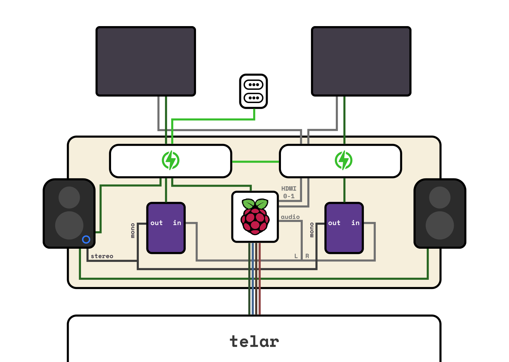

# TTT2 — La Piel Tejida

## Repositorio de desarrollo experimental



**Figura 1.** Arquitectura experimental TTT2: superficie textil interactiva, adquisición gestual mediante sensores 
capacitivos y generación audiovisual en tiempo real.

---

# Descripción

Este repositorio documenta el desarrollo experimental de **TTT2 — La Piel Tejida**, un prototipo de interfaz 
textil interactiva desarrollado dentro del proyecto:

**La Piel Tejida: Codificar y Significar mediante una Proto-Escritura desde una Constelación de Lenguajes.**

TTT2 explora la superficie textil conductiva como una interfaz sensible donde el gesto corporal genera respuestas 
audiovisuales mediante la relación entre:

* superficie textil sensible
* interacción corporal
* adquisición gestual
* sonido generativo
* representación visual

El repositorio funciona como un registro de laboratorio experimental donde se documentan códigos, pruebas de 
hardware, configuraciones electrónicas y exploraciones audiovisuales.

---

# De TTT2 hacia TmaqT

TTT2 constituye el punto de partida experimental desde el cual surge la propuesta doctoral:

**TmaqT — Arquitectura Topológica Multimodal para el Modelado Adaptativo del Gesto en Interfaces 
Háptico-Textiles.**

Mientras TTT2 implementa una relación definida entre gesto, sonido e imagen mediante reglas de interacción 
preestablecidas, TmaqT explora la transición hacia sistemas capaces de aprender nuevas relaciones entre:

* interacción corporal
* espacio latente
* generación sonora
* comportamiento emergente

La pregunta central que articula esta evolución es:

> ¿Cómo pasar de una correspondencia fija gesto-respuesta a un sistema capaz de aprender relaciones nuevas entre 
interacción corporal, espacio latente y generación sonora?

Esta investigación explora nuevas posibilidades de creación artística mediante sistemas generativos, así como 
arquitecturas computacionales adaptativas aplicables a diferentes interfaces multimodales, más allá de una única 
tecnología textil.

---

# TTT2 — Arquitectura experimental

La primera implementación consiste en una superficie textil conductiva conectada a un sistema computacional capaz 
de interpretar interacciones táctiles y transformarlas en comportamientos audiovisuales.

Arquitectura:

```
GESTO CORPORAL
        |
        |
TEXTIL CONDUCTIVO
        |
        |
SENSORES CAPACITIVOS MPR121
(24 zonas táctiles)
        |
        |
RASPBERRY PI
        |
        |
SONIDO + VISUALIZACIÓN
(Pygame / Python)
```

---

# Tecnologías

## Hardware

* Raspberry Pi 4B
* 2 sensores capacitivos MPR121
* 24 zonas táctiles
* superficie textil conductiva
* pedales de control complementarios

## Software

* Python
* Pygame
* NumPy
* comunicación I2C para adquisición sensorial

---

# Implementación experimental

La primera versión funcional del sistema integra:

* lectura de sensores capacitivos
* detección de interacción táctil
* activación y mezcla de capas sonoras
* control dinámico de volumen y transiciones
* generación visual en tiempo real
* relación entre gesto corporal, superficie textil y respuesta computacional

El sistema utiliza una correspondencia determinista entre interacción y respuesta audiovisual, permitiendo 
investigar cómo una superficie material puede transformarse en una interfaz expresiva basada en el gesto.

La incorporación de pedales como elementos de control complementarios amplía la interacción desde el contacto 
manual hacia una experiencia corporal distribuida, donde diferentes acciones del cuerpo generan variaciones dentro 
del comportamiento audiovisual.

---

# Evolución experimental

## Etapa 1 — Prototipo inicial

Implementación de:

* adquisición capacitiva
* interacción textil
* activación sonora
* visualización generativa

## Etapa 2 — Exploraciones audiovisuales

Investigación de:

* capas sonoras
* mezcla dinámica
* variación temporal
* relaciones gesto-sonido

## Etapa 3 — Hacia sistemas adaptativos

Primeras exploraciones hacia:

* representación del gesto
* espacios latentes
* Self-Organizing Maps (SOM)
* modelos generativos de sonido
* aprendizaje automático no supervisado

---

# Relación con TmaqT

TmaqT representa la evolución desde una interfaz reactiva hacia una arquitectura adaptativa basada en aprendizaje 
automático, representación latente y organización topológica del gesto.

La investigación doctoral plantea desarrollar sistemas capaces de establecer nuevas relaciones entre cuerpo, 
materia, datos y sonido, tanto como herramientas de exploración artística para nuevas formas de expresión 
audiovisual, como arquitecturas computacionales aplicables a interfaces multimodales sensibles, superficies 
deformables y otros dispositivos basados en la captura e interpretación del gesto humano.

---

# Referencia

TTT2 — La Piel Tejida corresponde a la investigación de tesis de Magíster en Artes Mediales, Universidad de Chile, 
2025.

https://www.academia.edu/144409160/TTT2_La_Piel_Tejida_Codificar_y_Significar_mediante_una_proto_Escritura_Desde_una_constelaci%C3%B3n_de_lenguaje_s_

