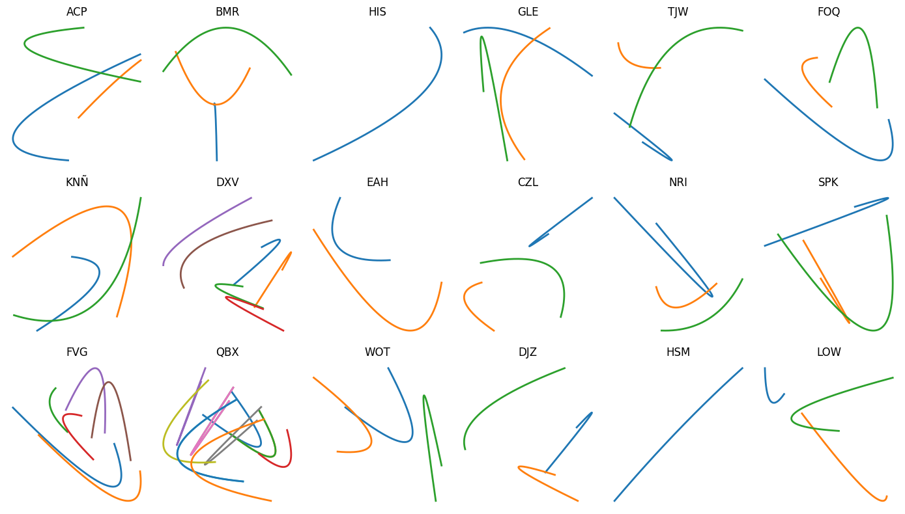

# TTT2 — La Piel Tejida
## Repositorio de desarrollo experimental

---

## Descripción

Este repositorio documenta el desarrollo experimental de **TTT2 (La Piel Tejida)** y las primeras 
exploraciones técnicas que dieron origen a la propuesta doctoral:

**TmaqT — Arquitectura Topológica Multimodal para el Modelado Adaptativo del Gesto en Interfaces 
Háptico-Textiles.**

El proyecto explora la relación entre:

- superficies textiles sensibles
- interacción corporal
- sonido generativo
- modelos computacionales adaptativos

El repositorio funciona como un registro de laboratorio donde se documentan códigos, pruebas de 
hardware y experimentaciones audiovisuales.

---

# TTT2 — La Piel Tejida

TTT2 es un prototipo de interfaz textil interactiva desarrollado dentro del proyecto:

*La Piel Tejida: Codificar y Significar mediante una Proto-Escritura desde una Constelación de 
Lenguajes.*

La superficie textil conductiva funciona como una interfaz donde el gesto corporal genera respuestas 
audiovisuales.

## Arquitectura inicial
GESTO
|
v
TEXTIL CONDUCTIVO
|
v
MPR121
24 zonas capacitivas
|
v
RASPBERRY PI
|
+-------------+
| |
v v
SONIDO VISUAL
WAV Pygame

---

# Tecnologías

## Hardware

- Raspberry Pi
- 2 x MPR121
- 24 zonas capacitivas
- Superficie textil conductiva

## Software

- Python
- Pygame
- NumPy

---

# Evolución experimental

## Etapa 1 — Prototipo inicial

Implementación del sistema interactivo:

- lectura capacitiva
- activación sonora
- visualización generativa
- interacción en tiempo real

## Etapa 2 — Exploraciones audiovisuales

Pruebas con:

- capas sonoras
- mezcla dinámica
- variación temporal
- nuevas relaciones gesto-sonido

## Etapa 3 — Hacia sistemas adaptativos

Primeras exploraciones hacia:

- representación del gesto como datos
- espacios latentes
- Self Organizing Maps (SOM)
- modelos generativos de sonido

---

# Relación con TmaqT

TTT2 constituye el punto de partida experimental desde el cual surge la propuesta TmaqT.

TTT2 = punto de partida experimental, interfaz textil reactiva con mapeos definidos.
TmaqT = evolución hacia una arquitectura adaptativa con aprendizaje computacional.

"pasar de una correspondencia fija gesto-respuesta a un sistema capaz de aprender relaciones nuevas 
entre interacción corporal, espacio latente y generación sonora."
